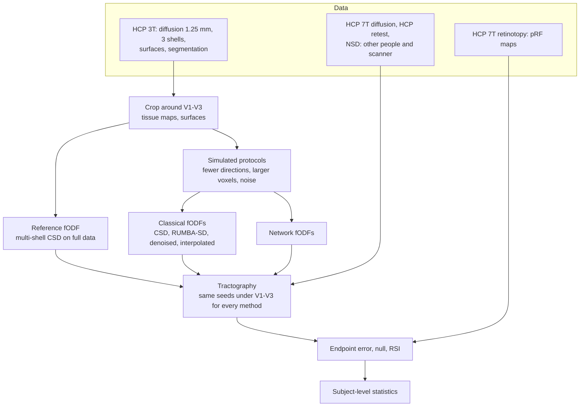
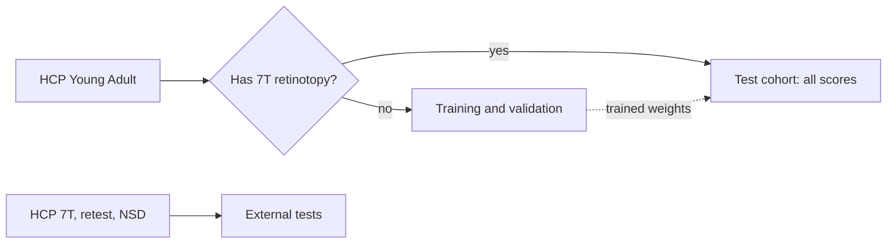
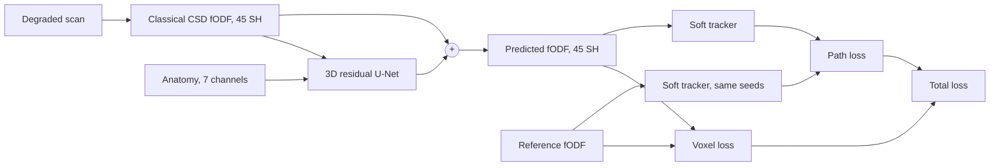

# Overview

## Question

Each point of V1, V2 and V3 responds to one location of the visual field (retinotopy), and the short fibres that
join these areas connect points that represent the same location. High-quality diffusion MRI shows this.
Clinical-grade scans (fewer directions, larger voxels, one b-value) give less accurate fibre orientation
distributions (fODFs) voxel by voxel, but classical CSD keeps most of its retinotopic specificity, so there is
little room for any method to improve on it. Networks that enhance fODFs exist, but they are trained and judged
voxel by voxel, which says little about where a streamline crossing twenty voxels ends.

This project asks what learned enhancement does to this fine-scale connectivity: whether a network trained on
voxel error alone raises voxel-wise accuracy but lowers retinotopic specificity below the classical CSD fODF it
starts from, a loss that voxel-wise accuracy does not show and the retinotopic score does; and whether training it
on paths as well removes that loss. Reference scans to train on are scarce in practice, so the networks are
trained on 12 subjects, and the comparison is repeated with 35 and 100 to see how it changes with the amount of
training data. The organisation itself is known; it is used as the reference that a tractogram either reproduces
or does not.

## What we do

1. **Score tractograms against measured retinotopy.** For every streamline between two of V1–V3, the endpoint
   error is the visual-field distance between the measured pRF centres of its two ends. Nearby cortex has similar
   retinotopy, so each streamline is compared with surrogates that keep one end and move the other to a point of
   the same area at the same distance. `RSI = 1 − median(error) / median(surrogate error)`: 0 is no better than
   distance alone, 1 is perfect.
2. **Map the loss** of RSI as the HCP reference data are degraded towards clinical-grade protocols.
3. **Train a network with a path-consistency loss.** A 3D U-Net corrects the classical CSD fODF of a degraded
   scan towards the reference fODF. A
   differentiable tracker follows short paths from seeds under the cortex through the predicted and the reference
   fODF, and the distance between the two paths is penalised. Retinotopy is never used in training.
4. **Compare each network with the classical CSD fODF it starts from** on voxel-wise accuracy (ACC), RSI and the
   path error: the distance between paths traced through the network's fODF and through the reference fODF on
   the test subjects.
5. **Repeat with more training subjects** (35 and 100) and report how each comparison changes with training size.

| | Hypothesis |
|---|---|
| H1 | On full-quality data, V1–V2, V2–V3 and V1–V3 streamlines have RSI > 0 |
| H2 | A voxel-loss network gains more voxel-wise accuracy than retinotopic specificity (tested as: recovery of ACC > recovery of RSI, relative to classical CSD and the reference) |
| H3 | Adding the path loss to the same network gives higher RSI on the clinical-grade protocols without lower voxel accuracy |

H1 to H3 form the confirmatory family. H3 is decided by two networks that differ only in the loss (`path` vs
`voxel`). A second pre-specified family compares the networks with classical CSD on each clinical-grade protocol:
RSI of `voxel` lower than classical CSD, RSI of `path` not worse than classical CSD, ACC of `path` higher than
classical CSD, and path error of `path` lower than classical CSD and than `voxel`
([07-scoring.md](07-scoring.md#comparison-with-classical-csd-csd_comparison_testscsv-holm-within-this-family)).
Both families are tested on the networks trained with 12 subjects. The same tests on the networks trained with 35
and 100 subjects are the training-size analysis
([07-scoring.md](07-scoring.md#training-size-training_size_testscsv)).

## Pipeline

Only a box around V1–V3 is processed, on a 1.25 mm grid. HCP and NSD files are each in one subject space, so
there is no registration step. Every method is tracked on the same grid with the same tissue maps, seeds and
settings, so methods differ only in the fODF.

## Subjects

No subject with measured retinotopy is used in training. Lists are drawn once with the seed (`outputs/subjects.json`).
The subjects looked at while the method and its settings were chosen (`development_subjects` in `config.yaml`)
are left out of every test list (test, 7T, retest); the experiments run on them are in [09-development.md](09-development.md).

## Network and loss

Methods compared on the same footing: classical CSD, RUMBA-SD, CSD after denoising or after interpolation, a
voxel-wise MLP and a U-Net that read the diffusion signal, the CSD-correcting network with the voxel loss only and
with the path loss, its ablations, and a proximity-only bound that ignores diffusion. Probabilistic tracking of the
same fODFs checks that conclusions do not depend on the tracker. Besides the measured pRF maps, every tractogram
is also scored with the group-average pRF maps and with an anatomical atlas (Benson 2014), the only key a clinical
dataset would have.

## Notebooks

| Notebook | Does | Writes (`outputs/results/` unless noted) |
|---|---|---|
| `00_env_check` | Versions, device, HCP keys | — |
| `01_download_data` | Downloads, subject lists | `data/`, `outputs/subjects.json` |
| `02_preprocessing` | Crops, reference fODFs, network inputs | `data/cache/` |
| `03_retinotopy_metric` | Reference tractogram and proximity bound (H1) | `h1_reference.csv` |
| `04_protocol_map` | Classical methods on every protocol; probabilistic tracker | `protocols.csv` |
| `05_training` | All network variants | `outputs/models/` |
| `06_inference_eval` | Networks on the clinical-grade protocols (H2, H3); path error of CSD and the networks | `learned.csv`, `path_error.csv` |
| `07_external_tests` | HCP 7T, HCP retest, NSD | `external_*.csv`, `retest_*.csv`, `nsd_run_overlap.csv` |
| `08_ablations_robustness` | Other analysis choices, ablations | `robustness.csv` |
| `09_stats_figures_tables` | Tests, comparison with classical CSD, training size, pairwise comparisons, summary tables | `*_tests.csv` (including `confirmatory_tests.csv`, `csd_comparison_tests.csv`, `training_size_tests.csv`), `*_results.csv` |
| `10_figures` | Paper figures, from saved files only | `outputs/figures/fig*.pdf`, `.png` |

Details: [05-preprocessing.md](05-preprocessing.md), [06-network.md](06-network.md), [07-scoring.md](07-scoring.md),
[08-code.md](08-code.md).
