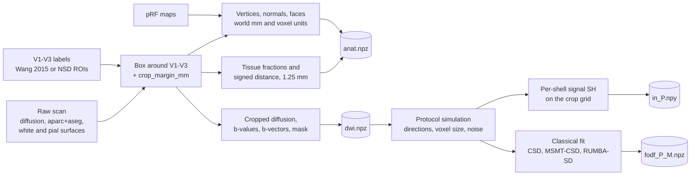

# Preprocessing and fODF reconstruction

From raw scans to the cached crop of one session, the simulated protocols, the network inputs and the classical
fODFs. Code: [subject.py](../src/retinopath/subject.py) (HCP), [nsd.py](../src/retinopath/nsd.py) (NSD),
[atlas.py](../src/retinopath/atlas.py) (atlas key), [degrade.py](../src/retinopath/degrade.py) (protocols),
[recon.py](../src/retinopath/recon.py) (spherical harmonics and fODF fits), called through `prepare`,
`protocol`, `net_input` and `fodf` in [pipeline.py](../src/retinopath/pipeline.py).

## Sessions

A session is one scan of one subject (`pipeline.session`), cached in `data/cache/<tag>/`.

| `kind` | Data | Tag | Anatomy |
|---|---|---|---|
| `3T` | HCP 1200 release, 3T diffusion | `<sid>` | 3T T1w space |
| `7T` | HCP 1200 release, 7T diffusion of the same person | `<sid>_7T` | the 3T T1w anatomy |
| `retest` | HCP Retest release, second visit | `<sid>_retest` | surfaces and segmentation of the retest visit |
| `nsd`, `nsd2` | NSD diffusion run 1 or 2 | `subjNN_nsd`, `subjNN_nsd2` | NSD FreeSurfer surfaces, 0.8 mm segmentation |

HCP diffusion, anatomy and surfaces are distributed in one subject space (T1w), and so are the NSD files, so
there is no registration step.

## HCP crop (`subject.build_anat`, `subject.load_dwi_crop`)

1. **Surfaces** (`load_surfaces`). White and pial surfaces on the fsLR 32k mesh
   (`*_MSMAll.32k_fs_LR.surf.gii`, 32,492 vertices per hemisphere) for the hemispheres in `hemis`. The outward
   normal of a vertex is the unit vector from its white-surface to its pial-surface position.
2. **Areas** (`load_wang`). V1, V2, V3 from the group atlas of Wang et al. (2015) in `atlas.mat`, defined on the
   same fsLR mesh, so vertex *i* has the same label in every subject. V1v/V1d → 1, V2v/V2d → 2, V3v/V3d → 3; the
   dorsal flag is kept for the dorsal/ventral analysis. `atlas.mat` and `prfresults.mat` hold values for the
   59,412 cortical vertices only; `assets/fslr32k_cortex_index.npz` (29,696 left, 29,716 right indices) places
   them on the 32,492-vertex meshes. It is a property of the standard HCP mesh and holds no subject data.
3. **Box** (`crop_box`, `shifted_affine`). Voxel bounding box of all V1–V3 white-surface vertices, enlarged by
   `crop_margin_mm` (12 mm) on every side and clipped to the image. Only this box is processed. The image affine
   is shifted to the box origin.
4. **Tissue maps** (`tissue_maps`). The FreeSurfer segmentation `aparc+aseg.nii.gz` (0.7 mm) is cut to the box
   plus 6 mm and split into:
   - white matter: labels 2, 41 (cerebral white matter), 7, 46 (cerebellar white matter), 16 (brainstem),
     28, 60 (ventral DC), 77 (white-matter hypointensities), 85 (optic chiasm), 251–255 (corpus callosum);
   - CSF: 4, 5, 14, 15, 24, 43, 44 (ventricles, CSF), 31, 63 (choroid plexus) and the background label 0;
   - grey matter: everything else.

   Each 0.7 mm voxel is assigned to its nearest crop voxel and the masks are averaged, giving partial-volume
   fractions `pve = (wm, gm, csf)` on the crop grid. The signed distance to the white-matter boundary is computed
   on the 0.7 mm grid (Euclidean distance transform, negative inside white matter, mm) and averaged the same way
   into `sdist`.
5. **Vertex arrays.** All vertices of the chosen hemispheres are kept, because geodesic distances need the whole
   mesh: world position `verts`, normal `normals`, the same in crop-voxel units (`verts_vox`, `normals_vox`),
   hemisphere index `hemi` (0 = first entry of `hemis`), `area`, `dorsal`, `vert_id` (index on the original mesh)
   and the triangles `faces`.
6. **Normal field.** For every crop voxel within 5 mm of a white-surface vertex, the inward normal of the nearest
   vertex (`normal_field`, three channels, zero elsewhere). It tells the network which way the cortex is.
7. **Retinotopy** (`load_prf`). For subjects in the HCP 7T retinotopy release: polar angle, eccentricity and
   variance explained per vertex from `prfresults.mat`, each with three fits: all runs, first half of the runs,
   second half. Subjects without retinotopy (training and validation) have no `prf_*` arrays.
8. **Diffusion** (`load_dwi_crop`). `data.nii.gz` is read only inside the box. b-values are rounded to the nearest
   1000 (HCP 3T: 18 b=0 volumes and 90 directions at each of b = 1000, 2000, 3000), b-vectors are read as (N, 3),
   and `nodif_brain_mask.nii.gz` is cut to the box.

### 7T scans

HCP 7T diffusion is 1.05 mm, b = 1000 and 2000. The box is computed on the 7T grid and then put on the 1.25 mm
grid over the same field of view (`shape_native` keeps the original size). The diffusion volume is resampled to
it with the low-pass filter of the protocol simulation, and the mask with trilinear interpolation thresholded at
0.5. Every later step and every network therefore sees 1.25 mm voxels. The anatomy is the 3T anatomy of the same
person, so `prepare` downloads the 3T files for a 7T session when they are missing.

## NSD crop (`nsd.build_anat`, `nsd.load_dwi_crop`)

Produces the same `anat` dictionary from NSD files:

- **Surfaces:** native white and pial surfaces in the diffusion space (`cortexmap/surf/*.cras.*.surf.gii`).
- **Areas:** each subject's hand-drawn `prf-visualrois` labels (V1v … V3d, mapped to 1–3 as for HCP).
- **Retinotopy:** `prfangle`, `prfeccentricity`, `prfR2`. NSD has one pRF fit, so the split-half columns are NaN
  and there is no noise ceiling for NSD.
- **Box:** around the V1–V3 vertices on the distributed 0.8 mm grid, then put on 1.25 mm like the 7T case
  (`shape08` keeps the 0.8 mm size). Tissue maps come from `aseg_0pt8.nii.gz` with the same labels as HCP.
- **Vertices:** the native meshes are dense (about 10,000 V1–V3 vertices per hemisphere), so vertices outside the
  box are dropped; `vert_id` keeps the native index and `faces` keeps only triangles inside the box.
- **Group-average key** (`template_prf`, `bridge_file`): the HCP group-average pRF maps (subject ID 999999)
  carried to the NSD vertices through fsaverage. Each native vertex, at its position on `sphere.reg` (the
  subject's registration to fsaverage), takes the value of the nearest vertex of HCP's sphere that places the
  fsLR 32k mesh on fsaverage. Stored as `tpl_ang`, `tpl_ecc`, `tpl_r2`.
- **Diffusion:** the 0.8 mm crop is resampled to 1.25 mm without extra smoothing (the acquisition was 1.5 mm).
  b-values are rounded to the nearest 500 (b = 1500 and 3000). The x component of the b-vectors is flipped
  (`nsd.flip_x`), which the orientation of these files requires. The mask is every voxel with a positive b=0
  signal.

## Atlas key (`atlas.py`)

The Benson et al. (2014) atlas (template version 4.0, distributed with neuropythy) predicts polar angle,
eccentricity and visual area from cortical folding on fsaverage. `atlas_files` downloads the three maps per
hemisphere and the fsaverage sphere once. `atlas_key_source` gives every vertex of a session the value of the
nearest fsaverage vertex on the registered sphere: for HCP the fsLR-on-fsaverage sphere, for NSD the subject's
`sphere.reg`. The atlas stores polar angle as 0° (upper vertical meridian) to 180° (lower vertical meridian) in
each hemisphere; `fsaverage_maps` converts it to the convention of the measured maps (0° = right horizontal
meridian, 90° = upper vertical, counter-clockwise): `90 − angle` (mod 360) for the left hemisphere, which sees
the right visual field, and `90 + angle` for the right hemisphere. A vertex is valid for this key where the
atlas puts it in V1–V3: its `r2` is set to 100 there and 0 elsewhere, so the same validity rule applies as for
measured maps.

## Protocol simulation (`degrade.make_protocol`)

Each protocol in `config.yaml` is simulated from the session's own full-quality crop:

1. **Volumes** (`select_volumes`, `pick_directions`). The first `n_b0` (3) b=0 volumes, then for each shell
   `{b: n}` a subset of `n` directions chosen by greedy farthest-point sampling: starting from the first
   direction, the next is always the one with the smallest maximum |cos| to those already chosen (antipodal
   directions count as the same). Deterministic, so every subject gets the same subset. `all` keeps every
   direction.
2. **Voxel size** (`resample`). A separable Gaussian low-pass filter with FWHM = √(out² − in²) mm (the extra blur a
   larger voxel adds; SciPy, edges repeated), then trilinear resampling to the new isotropic voxel size over the same field of view. The
   affine is updated for the exact per-axis scale and the half-voxel shift of the voxel centres. Tissue fractions
   are resampled the same way.
3. **Noise** (`add_rician`). With `snr` set, Rician noise of σ = (mean b=0 signal in white matter) / snr: a
   Gaussian sample is added to the signal and a second one in quadrature, √((s + n₁)² + n₂²). It is added after
   resampling, so it belongs to the coarse acquired voxels and is not averaged away. White matter here is the
   voxels with wm > 0.9, or the purest 5% when a coarse grid has none that pure. The generator is seeded from
   `seed` and the subject ID, so a subject always gets the same noise.

`NATIVE` is the scan as acquired (7T, NSD), without simulation. Protocols are recomputed when needed and not
cached; their fODFs and network inputs are.

## Network input (`recon.signal_sh`, `pipeline.net_input`)

The network reads the diffusion signal, not an fODF, so one network handles every protocol.

- For each shell in `shells_in` (1000, 2000, 3000), the signal divided by the mean b=0 is clipped to [0, 2] and
  fitted with real even spherical harmonics of order `sh_order_in` (4, 15 coefficients) by regularised least
  squares: c = (BᵀB + λL)⁻¹Bᵀs with the Laplace–Beltrami penalty L = diag((l(l+1))²) and λ = 0.006.
- A shell with too few directions for order 4 is fitted at a lower order (`max_order`, below) and the remaining
  coefficients stay zero. A shell the protocol lacks is all zero. Voxels with no b=0 signal are zero.
- The 3 × 15 = 45 channels are resampled trilinearly from the protocol grid to the 1.25 mm crop grid and cached
  as float16 in `in_<protocol>.npy`.
- Seven anatomical channels are added at training and inference time (`pipeline.anat_channels`): wm, gm, csf
  fractions, signed distance / 5 mm clipped to [−2, 2], and the three components of the normal field.
- For the `fodrefine` baseline the input is the classical CSD fODF of the protocol on the crop grid
  (`in_<protocol>_fodf.npy`, 45 channels, no anatomy).

On NSD (b = 1500 and 3000) only the b = 3000 slot is filled; on HCP 7T (b = 1000 and 2000) the first two. The
networks therefore use only the b = 3000 shell of NSD.

## Classical fODFs (`recon.py`, `pipeline.fodf`)

### Conventions

- **Basis.** Real symmetric spherical harmonics of DIPY, `descoteaux07` with the legacy flag (`sh_matrix`). Even
  orders only; order 8 has 45 coefficients (`n_coef`). Every method returns order `sh_order_out` (8); a lower-order
  fit is zero-padded (`pad_order`), so all fODFs have the same 45 channels.
- **Mask.** fODFs are fitted where wm > `wm_mask_thr` (0.05) on the protocol grid and are zero elsewhere.
- **Order of a fit** (`max_order`). The highest even order up to 8 with at least 1.3 directions per coefficient:
  64 directions → 8, 32 → 6, 20 → 4, 12 → 2.
- **Single-fibre voxels** (`_top_fa`). The 300 voxels with the highest fractional anisotropy among those with
  wm > 0.95, from a tensor fitted on the shells up to b = 1500 (or the lowest shell when none is that low). They
  give the white-matter response functions.
- **Parallel fits.** Voxel-wise fits are split into 4 × `n_jobs` chunks and run with joblib (`_fit_parallel`).

### Methods

| Method name | Fit |
|---|---|
| `msmt_csd` | `ref_model` (multi-shell CSD by default); the reference, on protocol `REF` |
| `csd` | Multi-shell CSD if the protocol has two or more shells, else single-shell CSD |
| `rumba` | RUMBA-SD |
| `csd_mppca` | MP-PCA denoising of the protocol (DIPY `mppca`, patch radius 2), then `csd` |
| `csd_interp` | Diffusion images interpolated to the 1.25 mm crop grid first, then `csd` |
| `net_<variant>_s<seed>` | Network output, written by `train.net_fodf` ([06-network.md](06-network.md)) |

**Single-shell CSD** (`fit_csd`, Tournier et al. 2007). The highest-b shell and the b=0 volumes. The response is
axially symmetric: axial diffusivity = mean first tensor eigenvalue of the single-fibre voxels, radial = mean of
the other two, S0 = their mean b=0 signal. DIPY's `ConstrainedSphericalDeconvModel` at the order given by
`max_order`.

**Multi-shell multi-tissue CSD** (`fit_msmt`, Jeurissen et al. 2014). Responses for white matter (single-fibre
voxels), grey matter (gm > 0.97) and CSF (csf > 0.97); voxels whose b=0 signal is below 20% of the white-matter
median are left out of the grey-matter and CSF responses. DIPY builds the model (`MultiShellDeconvModel`,
order 8). Its fit is a small quadratic programme per voxel:

    minimise ||X x − s||²   subject to   C x ≥ 0

with `s` the voxel's signal, `X` the multi-tissue design matrix and `C` evaluating the fODF and the two isotropic
compartments on a dense sphere. DIPY solves it voxel by voxel with cvxpy, which is slow for a whole crop.
`solve_qp_batch` solves all voxels at once with ADMM (variable split z = Cx ≥ 0, scaled dual u):

    x ← (Xᵀs + ρ Cᵀ(z − u)) (XᵀX + ρ CᵀC)⁻¹
    z ← max(C x + u, 0)
    u ← u + C x − z

The inverse is computed once; ρ = tr(XᵀX) / tr(CᵀC); 1,000 iterations, chunks of 50,000 voxels, float64; NumPy
on the CPU or PyTorch on CUDA. `fit_msmt(..., use_dipy=True)` runs DIPY's own solver to check it. The two
isotropic coefficients are dropped and the 45 white-matter coefficients returned.

**RUMBA-SD** (`fit_rumba`, Canales-Rodríguez et al. 2015). DIPY's `RumbaSDModel` with a tensor white-matter
response from the single-fibre voxels, `rumba_iters` (200) iterations, voxel-wise. Its fODF is defined on the 362
directions of `symmetric362` and converted to order-8 SH by least squares, so that it is tracked like every other
method.

`fit_fodf` dispatches: `msmt_csd` with two or more shells → `fit_msmt`; `rumba` → `fit_rumba`; anything else →
`fit_csd`. In `pipeline.fodf`, `csd`, `csd_mppca` and `csd_interp` ask for `msmt_csd`, so they become multi-shell
CSD on multi-shell protocols (V20, V25) and single-shell CSD on the single-shell clinical protocols.

### Grids

A protocol with larger voxels gives an fODF on its own coarser grid, stored with its affine and tissue fractions.
Before tracking and before voxel-wise comparison it is interpolated trilinearly to the 1.25 mm crop grid
(`pipeline.on_ref_grid`), so every method is tracked on the same grid with the same tissue maps.
