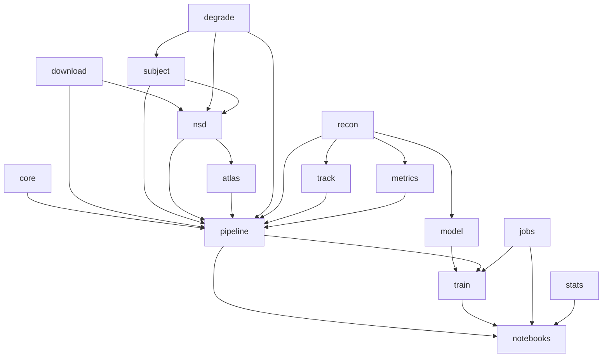
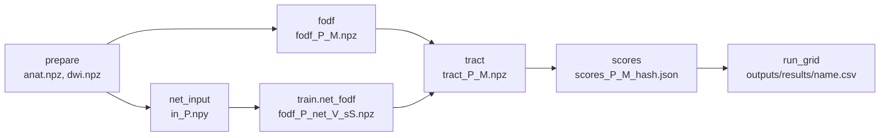

# Code reference

Every file, every module and its functions, the cached steps, what each notebook runs, and the format of every
file the code writes.

## Files

| File | Purpose |
|---|---|
| `config.yaml` | Every path and setting, commented in place ([04-configuration.md](04-configuration.md)) |
| `notebooks/00`–`10` | The experiment (below) |
| `scripts/setup.sh` | Creates `.venv` (Python 3.12–3.13), installs the pinned packages (CUDA 13 PyTorch on Linux), installs the package, registers the `retinopath` Jupyter kernel, runs a 3D convolution on the device |
| `scripts/download_data.sh` | `python -m retinopath.pipeline` for `full` or `dev`; `WORKERS` sets the number of parallel downloads |
| `scripts/run_all.sh` | Runs the download step in the terminal (live progress bars; `WORKERS` as above), then notebooks 00–10 in order. Each is copied to `outputs/executed/` with `DEV_MODE` set and executed there, so `notebooks/` stays clean |
| `scripts/run_notebook.sh` | Executes one notebook in place, with the `DEV_MODE` saved in it |
| `requirements.txt` | Pinned packages for macOS, including PyTorch |
| `requirements-dgx.txt` | The same pins for Linux with CUDA; PyTorch comes from the CUDA 13 wheel index |
| `pyproject.toml` | Installs `src/retinopath` as an editable package, with `assets/` |
| `.env.example` | Template for `.env`, which holds the HCP S3 keys |
| `.gitignore` | Keeps secrets, data, outputs, the environment and private working files out of git |
| `AGENTS.md` | Rules for changing the code and keeping the docs in step |

## Modules (`src/retinopath/`)

### `core.py`: configuration and run-time helpers

| Name | Does |
|---|---|
| `ROOT` | Project root |
| `Cfg` | dict with attribute access (`cfg.model.lr`) |
| `load_config(dev_mode)` | Reads `config.yaml`, copies the `dev:` or `full:` block over the top level, merges `extra_protocols` into `protocols`, resolves `paths` against the root (dev: `data/cache/dev`, `outputs/dev`), checks the cache settings |
| `CACHED_KEYS`, `check_cache_settings` | The settings cached files depend on are stored in `data/cache/settings.json`; if the cache already holds a crop and one of them changed, loading stops and names the key |
| `get_device` | CUDA, then MPS, then CPU |
| `seed_all` | Seeds Python, NumPy and PyTorch |
| `n_jobs` | CPU workers from `n_jobs`; negative values count back from all cores |
| `Timer` | Context manager that appends a stage's hours to `outputs/run_log.csv` and prints the running total |
| `atomic(path, write)` | Writes to a temporary file in the same folder and renames it onto `path` |
| `save_json`, `load_json` | JSON through `atomic` |

On macOS, importing `core` limits PyTorch to one CPU thread, because PyTorch's and DIPY's OpenMP runtimes crash
together otherwise.

### `download.py`: downloads

| Name | Does |
|---|---|
| `read_env` | `KEY=value` lines of `.env` |
| `hcp_client` | S3 client for `hcp-openaccess` with the keys in `.env` |
| `anon_client` | Unsigned S3 client for public buckets |
| `S3_CONFIG`, `S3_TRANSFER` | Both clients: up to 10 attempts per request, 30 s connect and 120 s read time-out, a pool of 512 connections; each file is fetched as 8 MB parts, 16 at a time (one connection gives only 1–2 MB/s) |
| `s3_get` | Downloads one object unless a file of the same size exists; writes to a name unique to the thread, then renames; `progress` receives the bytes as they arrive |
| `s3_size` | Size of an object, the bytes still to download (0 when the file on disk has that size) and its ETag |
| `http_get` | Downloads a URL with a progress bar, as 8 MB byte ranges 16 at a time (kept in `<file>.parts/` until complete) when the server allows it; time-outs are retried up to 8 times (10 s, 20 s, … up to 5 min apart) and a rerun continues from the parts on disk |
| `s3_dirs` | Sub-folder names under a prefix (all pages) |
| `s3_exists` | False only for a missing object; wrong keys or network errors raise |
| `hcp_keys`, `hcp_download` | The files of one HCP session: 3T = diffusion, mask, `aparc+aseg`, white and pial MSMAll surfaces; 7T = the diffusion files |
| `hcp_figure_keys` | Very inflated MSMAll surfaces of both hemispheres (figures only) |
| `osf_download` | `prfresults.mat` and `atlas.mat` from OSF (`http_get`) |
| `update_manifest` | Size and ETag of every downloaded file in `data/manifest.json` |

### `subject.py`: HCP crop ([05-preprocessing.md](05-preprocessing.md#hcp-crop-subjectbuild_anat-subjectload_dwi_crop))

| Name | Does |
|---|---|
| `subject_dir` | Raw folder of a subject (`data/hcp/<release>/<sid>/T1w`) |
| `prf_subject_ids` | Subject IDs in `prfresults.mat` |
| `load_prf` | pRF maps on the fsLR 32k mesh, three fits per vertex |
| `load_wang` | V1–V3 labels and dorsal flag from `atlas.mat` |
| `load_surfaces` | White-surface vertices, faces, outward normals |
| `inflated_surface` | Very inflated surface of one hemisphere, the same mesh as the white surface; `None` if not downloaded (figures only) |
| `crop_box`, `shifted_affine` | Box around a set of points; affine moved to the box origin |
| `tissue_maps` | Tissue fractions and signed distance on the crop grid |
| `build_anat` | The `anat` dictionary of an HCP session |
| `load_dwi_crop` | Cropped diffusion, b-values, b-vectors, mask |

### `nsd.py`: NSD crop ([05-preprocessing.md](05-preprocessing.md#nsd-crop-nsdbuild_anat-nsdload_dwi_crop))

| Name | Does |
|---|---|
| `nsd_keys`, `nsd_download` | The NSD files of one subject and run |
| `bridge_file` | HCP sphere placing the fsLR 32k mesh on fsaverage |
| `template_prf` | HCP group-average pRF on an NSD subject's vertices |
| `build_anat`, `load_dwi_crop` | Same outputs as `subject.py` |

### `atlas.py`: atlas key ([05-preprocessing.md](05-preprocessing.md#atlas-key-atlaspy))

| Name | Does |
|---|---|
| `atlas_files` | Downloads the Benson atlas maps and fsaverage sphere once |
| `fsaverage_maps` | Atlas on fsaverage with polar angle in the pRF convention |
| `atlas_key_source` | Atlas values at a session's vertices, in the layout of the measured maps |

### `degrade.py`: protocol simulation ([05-preprocessing.md](05-preprocessing.md#protocol-simulation-degrademake_protocol))

| Name | Does |
|---|---|
| `pick_directions` | Farthest-point subset of directions |
| `select_volumes` | b=0 and per-shell volume indices of a protocol |
| `resample` | Low-pass and trilinear resampling to a coarser voxel size; returns the new affine |
| `to_grid` | Trilinear resampling onto a grid with the same field of view |
| `add_rician` | Rician noise at a given white-matter b=0 SNR |
| `make_protocol` | One simulated protocol: volumes, voxel size, noise |

### `recon.py`: spherical harmonics and fODFs ([05-preprocessing.md](05-preprocessing.md#classical-fodfs-reconpy-pipelinefodf))

| Name | Does |
|---|---|
| `n_coef`, `sh_matrix`, `tracking_sphere` | SH size, SH evaluation matrix, the 724-direction sphere |
| `max_order` | Highest SH order the number of directions supports |
| `signal_sh` | Per-shell SH of the normalised signal (network input) |
| `gtab_of` | DIPY gradient table of a protocol |
| `fit_csd` | Single-shell CSD |
| `solve_qp_batch` | Batched ADMM for the constrained least-squares fit |
| `fit_msmt` | Multi-shell multi-tissue CSD |
| `fit_rumba` | RUMBA-SD, converted to SH |
| `pad_order` | Zero-pads a lower-order SH volume |
| `fit_fodf` | Chooses the fit for a method and pads to `sh_order_out` |

### `model.py`: networks and the path loss ([06-network.md](06-network.md))

| Name | Does |
|---|---|
| `N_ANAT` | Number of anatomical channels (7) |
| `Block`, `UNet3D` | Residual 3D U-Net |
| `VoxelMLP` | Per-voxel network |
| `FODRefine` | Residual fODF-to-fODF network |
| `build_model` | Builds a network kind with the configured sizes |
| `sample_trilinear` | Differentiable trilinear sampling of a volume at points |
| `PathTracer` | Soft tracker: amplitudes, start direction, step direction, trace |
| `path_loss` | Path-consistency loss (or the `onestep` direction loss) |
| `nonneg_loss` | Penalty on negative fODF amplitudes |

### `train.py`: training and inference ([06-network.md](06-network.md))

| Name | Does |
|---|---|
| `VARIANTS`, `apply_variant` | The network variants and their settings |
| `run_dir` | `outputs/models/<variant>_s<seed>/` |
| `load_volumes`, `sample_batch` | Training volumes on the device; random patches with path seeds |
| `net_in`, `losses` | Network input with or without anatomy; the total loss and its parts |
| `predict` | Whole-crop inference |
| `auto_batch` | Largest batch that fits in memory |
| `train` | One training run, resumable (also `python -m retinopath.train --variant V --seed S [--dev]`) |
| `take_over`, `_alive` | One process per run folder |
| `clear_outputs` | Removes cached outputs of an earlier network with the same name |
| `load_trained`, `net_fodf`, `trained_runs` | Load a trained network, write its fODF for a session, list finished runs |

### `jobs.py`: running training runs ([06-network.md](06-network.md#running-training-runs-jobspy))

| Name | Does |
|---|---|
| `n_gpus` | Number of CUDA devices |
| `train_commands` | One command per training run in `config.yaml` |
| `run_jobs` | Runs the commands over all GPUs and nodes; forwards an interrupt to every local run |

### `track.py`: tractography ([07-scoring.md](07-scoring.md#tractography-trackpy-pipelinetract))

| Name | Does |
|---|---|
| `make_seeds` | Seeds under the V1–V3 white surface and their vertex |
| `run_tracking`, `_track` | Particle-filter or probabilistic tracking (probabilistic in a child process on macOS) |
| `endpoints` | Nearest white-surface vertex of each end, and length |
| `area_pairs` | Streamlines between two different areas of V1–V3 |
| `density_map` | Streamlines per voxel |

### `metrics.py`: scores ([07-scoring.md](07-scoring.md))

| Name | Does |
|---|---|
| `PAIRS` | Pair codes 12, 23, 13 and their names |
| `get_key` | Visual-field position and validity of every vertex |
| `endpoint_error` | Visual-field, eccentricity and angle error per streamline |
| `build_graph` | Surface mesh graph for geodesic distances |
| `null_error` | Distance-matched surrogate errors |
| `rsi` | Retinotopic specificity index |
| `retinotopic_scores` | All retinotopic scores of one tractogram |
| `noise_ceiling` | Split-half pRF disagreement |
| `binned_auc` | Binned eccentricity AUC |
| `weighted_dice`, `bundle_adjacency` | Overlap of two tractograms |
| `voxel_metrics` | Angular correlation and peak error of an fODF against the reference |

### `pipeline.py`: cached steps and result tables

| Name | Does |
|---|---|
| `CLASSICAL`, `split_method` | Method name → fODF fit and tracker |
| `session`, `cfg_for`, `sdir` | Session description, NSD settings, cache folder |
| `prepare` | Download if needed and cache the crop |
| `load_anat`, `load_dwi` | Read the cached crop |
| `group_key_source` | Group-average key on a session's vertices |
| `protocol` | A simulated protocol, or the scan as acquired (`NATIVE`) |
| `anat_channels`, `net_input` | Anatomical channels; cached network input |
| `fodf`, `save_fodf`, `on_ref_grid` | Cached fODF; resampling to the crop grid |
| `tract`, `proximity_tract`, `streamlines_of` | Cached tractogram; proximity bound; streamlines from a stored tractogram |
| `scores` | Cached result row |
| `retest_scores` | Reproducibility between two scans |
| `make_subject_lists` | Subject lists |
| `run_grid` | Scores for sessions × (protocol, method), saved as a CSV |
| `download_all` | Every file a configuration needs (also `python -m retinopath.pipeline [--dev] [--workers N] [--list]`) |

### `stats.py`: statistics ([07-scoring.md](07-scoring.md#statistics-statspy-notebook-09))

`hodges_lehmann`, `rank_biserial`, `bootstrap_ci`, `paired_test`, `correct`, `mixed_model`.

### `assets/fslr32k_cortex_index.npz`

Indices of the cortical vertices on the standard fsLR 32k meshes (29,696 left, 29,716 right). Places
grayordinate data (retinotopy, Wang labels) on the meshes.

## Cached steps

Every step writes one file per session (and protocol, method) under `data/cache/<tag>/` and returns that file on
later calls, so running a notebook twice redoes nothing. Every file is written through `core.atomic`.

- **Method names.** The part before `+` is the fODF: `msmt_csd`, `csd`, `rumba`, `csd_mppca`, `csd_interp`,
  `net_<variant>_s<seed>`, or `proximity`. The part after is the tracker: `prob`; no suffix means particle
  filtering. `csd` and `csd+prob` share `fodf_
_csd.npz`.
- **Protocol names.** Those under `protocols` and `extra_protocols` in `config.yaml`, and `NATIVE` for a scan as
  acquired.
- **`run_grid`.** Missing fODFs are fitted first in the main process (the fits use all cores, or the GPU for
  multi-shell CSD). Tracking and scoring then run one session per joblib worker, because the tracker is
  single-threaded. Each worker loads the anatomy once and builds the group-average key, the atlas key and the
  surface graph for all combinations of its session.
- **`cfg_for`.** NSD sessions use `nsd.seeds_per_vertex` and `nsd.ecc_max`.
- **`keep_raw: false`.** `prepare` deletes a subject's raw HCP diffusion folder once its crop is cached.

### Subject lists (`make_subject_lists`)

Drawn once with `seed` and saved to `outputs/subjects.json`; later calls read the file.

- `test`: random subjects of the HCP 7T retinotopy release (group averages 9999xx excluded) that have 3T diffusion.
- `train`, `val`: random HCP 1200 subjects in neither the retinotopy release nor the retest release that have 3T
  diffusion.
- `t7`: the first `n_7t` test subjects that have 7T diffusion.
- `retest`: subjects with retinotopy and a retest diffusion scan.
- `nsd`: `subj01` … `subjNN` for `n_nsd`.

In dev the lists are the subjects named under `dev: subjects:`. The function stops if fewer test, training or
validation subjects exist than requested.

### Downloads (`download_all`)

Fetches the retinotopy files, builds the subject lists, then downloads every session of the configuration whose
crop is not cached yet, in parallel threads: HCP 3T for test, training, validation and retest subjects, HCP 7T for
`t7`, HCP retest, and both NSD runs. It also fetches the sphere and atlas files and the very inflated surfaces of
the test subjects (for Figure 1; fetched even when their crop is cached, so a cache made earlier gets them too), and
updates the manifest. It first asks S3 for the size of every file and prints how many files and gigabytes are
still missing; one bar, `whole dataset`, then counts bytes against that total, with speed, time left and files done.
`--list` only builds the lists and counts the sessions.

## Notebooks

Each starts with the same cell (notebook 10 a shorter one without device and seeding): `DEV_MODE`, imports, `cfg = load_config(DEV_MODE)`, the device, seeding, and the
`results/` and `figures/` folders of the output directory. Every stage runs inside a `Timer`. All work goes
through the cached steps above.

| Notebook | Runs | Writes |
|---|---|---|
| `00_env_check` | Package versions, `.venv`, free disk, GPUs with memory, nodes; U-Net forward and backward pass on the device; HCP keys present (never printed) and bucket reachable | — |
| `01_download_data` | `download_all`, `make_subject_lists` | `data/`, `outputs/subjects.json` |
| `02_preprocessing` | Crops all sessions (test, training, validation, retest, 7T); reference fODF of the 3T and retest sessions (on the GPU if there is one); network inputs of every training protocol for the training and validation subjects, and CSD fODF inputs when `fodrefine` is a variant; quality-check figure | `data/cache/`, `qc_preprocessing.png` |
| `03_retinotopy_metric` | Reference (`REF`, `msmt_csd`) and proximity bound on every test subject; RSI under the three keys; RSI per pair and axis | `h1_reference.csv`, `h1_rsi.png` |
| `04_protocol_map` | `csd` on every protocol but REF; `rumba`, `csd_mppca`, `csd_interp`, `csd+prob` on the clinical-grade protocols; `msmt_csd+prob` and `rumba` on REF; method × protocol map | `protocols.csv`, `protocol_map.png` |
| `05_training` | Every training run on every GPU and node; validation curves | `outputs/models/`, `outputs/logs/`, `training_curves.png` |
| `06_inference_eval` | Every finished network on the clinical-grade protocols of every test subject; tracking and scores | `learned.csv` |
| `07_external_tests` | HCP 7T: CSD and the `path`, `voxel`, `mlp`, `fodrefine` networks on the 7T scans. HCP retest: reference pipeline on the retest scans and test–retest agreement. NSD: crop, the same networks, CSD, `csd+prob` and proximity on run 1; CSD on run 2 and run-to-run agreement. No reference comparison (`ref=None`) | `external_7t.csv`, `retest_rsi.csv`, `retest_overlap.csv`, `external_nsd.csv`, `external_nsd_run2.csv`, `nsd_run_overlap.csv` |
| `08_ablations_robustness` | Re-scores the reference tractograms with r² ≥ 5% and ≥ 20%, null tolerance 5% and 20%, eccentricity ≤ 5° and ≥ 1°, each pRF half, and dorsal, ventral, left and right subsets (more than 50 streamlines); ablation networks per variant and protocol | `robustness.csv` |
| `09_stats_figures_tables` | Confirmatory and exploratory tests, pairwise comparisons of all methods, mixed model, other keys, summary tables (median [IQR]), external comparisons, hours logged | `confirmatory_tests.csv`, `exploratory_tests.csv`, `pairwise_tests.csv`, `mixed_model.csv`, `alternative_key_tests.csv`, `main_results.csv`, `external_results.csv`, `external_tests.csv`, `reproducibility.csv` |
| `10_figures` | Paper figures, drawn only from cached anatomy and tractograms and the result tables; never tracks, trains or scores, so it can be re-run to restyle. Fig. 1: visual areas of the first test subject on the whole very inflated hemisphere (medial view), polar angle and eccentricity enlarged on V1–V3, and its reference streamlines on the white surface (medial-posterior view); without the inflated file panels a–c use the white surface. Fig. 2 (H1): like-to-like matrices of the reference tractogram (below) for eccentricity and polar angle, ratio by bin distance against the proximity bound, RSI per pair. Fig. 3: the V1–V2 streamlines of the same subject for reference, CSD, `voxel` and `path` on the first clinical protocol, coloured by V1-end eccentricity and by endpoint error, with that subject's RSI. Fig. 4 (H3): V1–V2 matrices of the same four; paired RSI per protocol; ACC against RSI for every method. Fig. 5 (H2): recovery of ACC against recovery of RSI, as in the H2 test. Fig. 6: HCP 7T, NSD, reproducibility. S1: every method; S2: robustness; S3: other keys; S4: FDR p-values of all pairwise comparisons | `fig1_*` … `fig6_*`, `figS1_*` … `figS4_*` (PDF and PNG, 300 dpi) |

Result tables are written to `outputs/results/`, figures to `outputs/figures/` (`outputs/dev/…` in dev mode).

**Like-to-like matrices (notebook 10).** For one area pair, both ends of each streamline are binned by a
retinotopic coordinate (eccentricity or polar angle) at quantiles of the subject's valid V1 values
(`prf.n_ecc_bins` bins, as in the binned AUC). Counts are summed over test subjects and training seeds and divided
by the counts independent ends would give (row total × column total / total), shown on a log scale from ½× to 2×.
The ratio removes uneven coverage but not distance; the distance-matched RSI is the controlled measure.

## File formats

`
` is a protocol, `<M>` a method. Dev mode uses the same layout under `data/cache/dev/` and `outputs/dev/`.

### Cache (`data/cache/<tag>/`)

| File | Contents |
|---|---|
| `anat.npz` | Crop geometry, tissue maps, surfaces, retinotopy (below) |
| `dwi.npz` | `dwi` (X, Y, Z, N) float32, `bvals` (N,), `bvecs` (N, 3), `mask` (X, Y, Z) |
| `in_
.npy` | (45, X, Y, Z) float16 signal SH on the crop grid |
| `in_
_fodf.npy` | (45, X, Y, Z) float16 CSD fODF on the crop grid (`fodrefine` input) |
| `fodf_
_<M>.npz` | `sh` (45, x, y, z) float16, `affine`, `pve` (3, x, y, z) float16, on the protocol grid |
| `tract_
_<M>.npz` | V1–V3 tractogram (below) |
| `scores_
_<M>_<hash>.json` | One result row |

`data/cache/settings.json` holds the cached settings; `data/manifest.json` every downloaded file with size and
ETag.

**`anat.npz`**

| Key | Shape | Meaning |
|---|---|---|
| `sid`, `hemis` | string | Subject ID; hemispheres in the crop, e.g. `LR` |
| `affine` | (4, 4) | Crop grid (1.25 mm) to world mm |
| `start`, `shape` | (3,) | Box origin in the original image; crop size in voxels |
| `shape_native` / `shape08` | (3,) | 7T / NSD: box size on the original grid |
| `pve` | (3, X, Y, Z) | White-matter, grey-matter, CSF fractions |
| `sdist` | (X, Y, Z) | Signed distance to the white-matter boundary (mm, negative inside) |
| `normal_field` | (3, X, Y, Z) | Inward surface normal near the white surface, zero elsewhere |
| `verts`, `normals` | (V, 3) | White-surface vertices and outward normals, world mm |
| `verts_vox`, `normals_vox` | (V, 3) | The same in crop-voxel units |
| `faces` | (F, 3) | Triangles |
| `hemi` | (V,) | Index into `hemis` |
| `area`, `dorsal` | (V,) | 0 / 1 = V1 / 2 = V2 / 3 = V3; dorsal flag |
| `vert_id` | (V,) | Index on the original mesh |
| `prf_ang`, `prf_ecc`, `prf_r2` | (V, 3) | Polar angle (deg), eccentricity (deg), variance explained (%); fits all runs, first half, second half |
| `tpl_ang`, `tpl_ecc`, `tpl_r2` | (V,) | NSD: HCP group-average pRF on the NSD vertices |

**`tract_
_<M>.npz`**

| Key | Meaning |
|---|---|
| `a`, `b` | End vertices of each kept streamline; `a` in the lower area |
| `pair` | 12, 23 or 13 |
| `length` | Length (mm) |
| `n_seeds`, `n_streamlines`, `n_both_cortex` | Seeds; streamlines returned; streamlines with both ends on the white surface |
| `density` | (X, Y, Z) streamlines per voxel |
| `points`, `offsets` | Streamline *i* is `points[offsets[i]:offsets[i+1]]` (world mm) |

### Outputs (`outputs/`)

| Path | Contents |
|---|---|
| `subjects.json` | `test`, `train`, `val`, `t7`, `retest`, `nsd` |
| `models/<run>/last.pt` | Checkpoint ([06-network.md](06-network.md#training-loop-traintrain)) |
| `models/<run>/log.json` | One row per epoch (below) |
| `models/<run>/pid` | Host and process ID of the process training the run |
| `logs/<run>.log` | Console output of a training run |
| `results/*.csv` | Result tables |
| `figures/*.png`, `figures/*.pdf` | Figures; `fig*` are the paper figures (notebook 10) |
| `run_log.csv` | `stage, hours, finished, ok` per notebook stage |
| `executed/*.ipynb` | Notebooks executed by `run_all.sh`, with outputs |

**Training log row:** `step`, `hours`, `hours_left`, `path_steps` (current path length), `train_voxel`,
`train_nonneg`, `train_path_mm` (last training batch; the path term only for variants that use it),
`val_voxel`, `val_nonneg`, `val_path_mm` (validation, full path length, every variant), and on CUDA `gpu_gb`
(peak allocated since the previous row) and `gpu_reserved_gb` (held by PyTorch).

### Result columns

Score rows, with `<pair>` one of `V1-V2`, `V2-V3`, `V1-V3`, `all`:

| Column | Meaning |
|---|---|
| `sid`, `kind`, `protocol`, `method` | Identifiers |
| `n_seeds`, `n_streamlines`, `n_both_cortex` | As in the tractogram |
| `n_pairs` | Streamlines joining two different areas of V1–V3 |
| `length_median` | Their median length (mm) |
| `n_valid` | Streamlines with both ends valid in the measured key |
| `n_<pair>` | Scored streamlines of the pair |
| `ree_median_<pair>`, `ree_null_median_<pair>` | Median visual-field endpoint error (deg), observed and null |
| `dlogecc_*`, `dang_*` | The same for log-eccentricity ratio and polar-angle difference (deg) |
| `rsi_ree_<pair>`, `rsi_dlogecc_<pair>`, `rsi_dang_<pair>` | RSI of each error, straight-line null |
| `rsi_ree_geodesic_<pair>` | RSI of the visual-field error, surface-distance null |
| `coverage_<pair>_V<k>` | Fraction of valid vertices of area *k* reached by an end of that pair |
| `auc_binned_<pair>` | Binned eccentricity AUC (no `all`) |
| `noise_ceiling_deg` | Split-half pRF disagreement (HCP) |
| `template_rsi_ree_<pair>`, `template_n_valid` | Group-average key |
| `atlas_rsi_ree_<pair>`, `atlas_n_valid` | Atlas key |
| `wdice_ref`, `badj_ref_mm` | Agreement with the reference tractogram (HCP 3T) |
| `acc`, `peak_err_deg` | fODF against the reference (HCP 3T) |

Reproducibility rows: `wdice_retest`, `badj_retest_mm`, `vertex_count_r`, `align_rms_mm`; `nsd_run_overlap.csv`
adds `rsi_run1`, `rsi_run2`.

Test rows: `n`, `median`, `hodges_lehmann`, `rank_biserial`, `p`, `ci_lo`, `ci_hi`; plus `p_holm` and
`significant`, or `p_fdr`.

## Conventions

- Surfaces, seeds and streamlines are in world mm of the subject's scan space; the network, soft tracker and
  patches work in voxel indices of the 1.25 mm crop grid. `affine` maps voxel indices to world mm.
- fODFs are 45 real symmetric SH coefficients, DIPY `descoteaux07` legacy basis, order 8.
- Polar angle: 0° = right horizontal meridian, 90° = upper vertical meridian. Angles in degrees.
