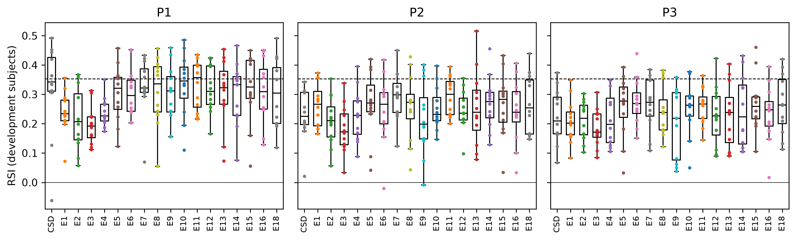

# Development experiments

How the network, its input and the settings of the path-consistency loss were chosen. Everything on this page was
measured on development subjects, which are listed in `development_subjects` of `config.yaml` and never enter the
test set. The numbers rank design choices; they are not results of the main experiment, which uses longer
training, both hemispheres and the test subjects only.

## Setup

- **Scored subjects:** 12 HCP Young Adult subjects with 7T retinotopy, hemisphere L:
  102816, 125525, 128935, 131217, 172130, 175237, 197348, 263436, 389357, 690152, 927359, 971160.
  Training: 12 subjects without retinotopy, validation: 3.
- **Protocols:** the reference (full HCP scan, multi-shell CSD) and the clinical-grade protocols
  P1, P2, P3; networks were trained on P1, P2, P3 together.
- **Training:** 1,500 steps (the long runs: 4,500), batch 4, patch 40, 32 base
  channels, on one Apple M4 GPU.
- **Tracking and scoring:** as in the main experiment, with 5 seeds per vertex and 50 distance-matched
  null partners. Until the section on the sampling threshold the tracker ran with DIPY's default threshold of
  0.1: median reference RSI 0.353; proximity-only control 0.036.
- **Scores:** RSI with the measured pRF key and with the anatomical-atlas key, voxel-wise angular correlation (ACC);
  see [07-scoring.md](07-scoring.md). Differences are paired by subject; p-values are two-sided Wilcoxon
  signed-rank tests, uncorrected, unless stated otherwise.

The runs used a working copy of the code. The designs that were kept are the variants of `model.VARIANTS`
([06-network.md](06-network.md)); the loss terms that were tried and dropped (E8, E9) are not in the code.

## Runs

| run | network | loss | steps | question |
|---|---|---|---|---|
| E1 | U-Net on the diffusion signal | voxel | 1500 | baseline of the first design |
| E2 | U-Net on the diffusion signal | voxel + path, cone 45° | 1500 | does the path loss raise RSI? |
| E3 | U-Net on the diffusion signal | voxel + 3 × path, cone 45° | 1500 | does a larger weight help? |
| E4 | U-Net on the diffusion signal | voxel + path, cone 20° | 1500 | cone equal to the scoring tracker's turning limit |
| E5 | CSD correction | voxel | 1500 | start from the classical CSD fODF instead of the signal |
| E6 | CSD correction | voxel + path, cone 20° | 1500 | path loss on the CSD-correction network |
| E7 | CSD correction | voxel + one-step direction loss | 1500 | direction loss without accumulation |
| E8 | CSD correction | voxel + fODF-shape loss (1 − angular correlation) | 1500 | does a higher ACC give a higher RSI? |
| E9 | CSD correction | voxel + 10 × one-step direction loss | 1500 | larger weight of the direction loss |
| E10 | CSD correction + anatomy input | voxel | 1500 | do the anatomical channels help? |
| E11 | CSD correction | voxel | 1500 | E5 with another training seed |
| E12 | CSD correction | voxel + one-step direction loss | 1500 | E7 with another training seed |
| E13 | CSD correction + anatomy input | voxel | 4500 | final design, longer training, seed 0 |
| E14 | CSD correction + anatomy input | voxel + path, cone 20° | 4500 | final design, longer training, seed 0 |
| E15 | CSD correction + anatomy input | voxel | 4500 | E13 with training seed 1 |
| E16 | CSD correction + anatomy input | voxel + path, cone 20° | 4500 | E14 with training seed 1 |
| E18 | CSD correction + anatomy input | voxel + path, cone 20° | 4500 | E14 with training seed 2 |

## Median scores over subjects

The reference and the proximity control do not depend on the protocol and are given once.

| method | RSI P1 | RSI P2 | RSI P3 | atlas RSI P1 | atlas RSI P2 | atlas RSI P3 | ACC P1 | ACC P2 | ACC P3 |
|---|---|---|---|---|---|---|---|---|---|
| reference | 0.353 |  |  | 0.329 |  |  |  |  |  |
| proximity | 0.036 |  |  | 0.024 |  |  |  |  |  |
| classical CSD | 0.342 | 0.225 | 0.210 | 0.310 | 0.282 | 0.289 | 0.882 | 0.765 | 0.638 |
| E1 | 0.234 | 0.267 | 0.202 | 0.291 | 0.295 | 0.301 | 0.795 | 0.777 | 0.732 |
| E2 | 0.207 | 0.210 | 0.218 | 0.301 | 0.232 | 0.265 | 0.769 | 0.750 | 0.708 |
| E3 | 0.192 | 0.172 | 0.172 | 0.226 | 0.184 | 0.180 | 0.713 | 0.693 | 0.656 |
| E4 | 0.227 | 0.228 | 0.198 | 0.305 | 0.285 | 0.233 | 0.787 | 0.766 | 0.722 |
| E5 | 0.321 | 0.271 | 0.277 | 0.349 | 0.307 | 0.298 | 0.891 | 0.819 | 0.709 |
| E6 | 0.297 | 0.267 | 0.268 | 0.326 | 0.318 | 0.361 | 0.892 | 0.823 | 0.714 |
| E7 | 0.321 | 0.299 | 0.273 | 0.368 | 0.319 | 0.319 | 0.892 | 0.821 | 0.708 |
| E8 | 0.336 | 0.273 | 0.238 | 0.322 | 0.295 | 0.297 | 0.895 | 0.825 | 0.716 |
| E9 | 0.312 | 0.199 | 0.219 | 0.361 | 0.313 | 0.249 | 0.892 | 0.819 | 0.707 |
| E10 | 0.346 | 0.231 | 0.263 | 0.321 | 0.322 | 0.274 | 0.894 | 0.825 | 0.746 |
| E11 | 0.357 | 0.300 | 0.267 | 0.358 | 0.282 | 0.328 | 0.892 | 0.818 | 0.710 |
| E12 | 0.310 | 0.236 | 0.227 | 0.307 | 0.303 | 0.271 | 0.892 | 0.817 | 0.709 |
| E13 | 0.323 | 0.239 | 0.239 | 0.306 | 0.271 | 0.256 | 0.889 | 0.831 | 0.758 |
| E14 | 0.333 | 0.276 | 0.223 | 0.322 | 0.323 | 0.301 | 0.891 | 0.834 | 0.764 |
| E15 | 0.325 | 0.283 | 0.259 | 0.313 | 0.282 | 0.242 | 0.889 | 0.830 | 0.758 |
| E16 | 0.309 | 0.239 | 0.247 | 0.388 | 0.303 | 0.312 | 0.892 | 0.833 | 0.760 |
| E18 | 0.305 | 0.254 | 0.264 | 0.317 | 0.259 | 0.305 | 0.892 | 0.835 | 0.764 |

## Paired comparisons

Each run against the run it differs from in one setting: median difference (subjects with a higher RSI, p).

| difference in RSI | P1 | P2 | P3 |
|---|---|---|---|
| E2 − E1 | -0.006 (6/12, p 0.47) | -0.050 (3/12, p 0.04) | -0.006 (5/12, p 0.85) |
| E3 − E1 | -0.053 (2/12, p 0.02) | -0.085 (1/12, p 0.00) | -0.005 (5/12, p 0.23) |
| E4 − E1 | -0.005 (5/12, p 0.85) | -0.033 (4/12, p 0.09) | +0.011 (7/12, p 0.73) |
| E5 − E1 | +0.062 (9/12, p 0.03) | +0.037 (8/12, p 0.62) | +0.041 (8/12, p 0.18) |
| E5 − classical CSD | -0.042 (4/12, p 0.27) | +0.074 (10/12, p 0.18) | +0.028 (8/12, p 0.34) |
| E6 − E5 | +0.011 (7/12, p 0.73) | -0.022 (3/12, p 0.23) | -0.000 (6/12, p 0.85) |
| E7 − E5 | +0.019 (9/12, p 0.23) | +0.017 (7/12, p 0.30) | +0.010 (6/12, p 0.62) |
| E8 − E5 | +0.009 (7/12, p 0.68) | -0.012 (5/12, p 0.62) | -0.020 (4/12, p 0.62) |
| E9 − E5 | +0.007 (7/12, p 0.79) | -0.064 (2/12, p 0.05) | -0.016 (6/12, p 0.34) |
| E10 − E5 | +0.024 (9/12, p 0.23) | -0.039 (5/12, p 0.38) | -0.005 (5/12, p 0.97) |
| E13 − classical CSD | -0.028 (3/12, p 0.47) | +0.034 (9/12, p 0.47) | -0.003 (6/12, p 0.79) |
| E14 − E13 | -0.004 (5/12, p 0.73) | +0.020 (8/12, p 0.30) | +0.023 (8/12, p 0.62) |

## What was decided

1. **Input and architecture.** On the diffusion signal the U-Net stayed below classical CSD on P1 after
   1,500 steps (E1: RSI 0.234, ACC 0.795; CSD: 0.342, 0.882). A network that reads the
   classical CSD fODF and adds a correction to it, with an output layer that starts at zero, begins as CSD and,
   with the default tracker, improves on it where CSD is weak (E5: RSI 0.271 on P2 and 0.277 on P3; CSD: 0.225 and 0.210), and the second
   seed agrees (E11: 0.300 and 0.267). This became the main network (`model.kind: refine`); the U-Net on
   the signal is kept as the baseline `signal`.
2. **Anatomy input.** Adding the anatomical channels lowered the validation loss (0.1642 against 0.1718) and
   raised ACC (P3: 0.746 against 0.709); RSI changed within the run-to-run variation. The architecture
   is chosen on the validation loss, so the channels are kept (`model.use_anat: true`; ablation `noanat`).
3. **Tracking cone of the path loss.** With a 45° cone the path loss lowered RSI on the first design (E2), and a
   weight of 3 lowered it further (E3). A 20° cone, the turning limit of the scoring tracker, removed most of the
   loss (E4). `model.path.cone_deg` is 20 and `model.lambda_path` stays 1.
4. **Other loss terms.** A loss on the fODF shape raised ACC but not RSI (E8), which is what H2 states: voxel-wise
   accuracy does not buy retinotopy. A one-step direction loss looked better in one run (E7) but the gain was
   gone with a second seed (E12) and a weight of 10 was worse (E9). Neither was adopted; the one-step loss is the
   ablation `onestep`.
5. **Path loss on the final network.** It lowers the path error on the validation subjects (5.379 mm against
   7.445 mm at 4,500 steps) without a higher voxel loss. Its effect on RSI is the subject of the last
   two sections.
6. **Sampling threshold of the scoring tracker.** `tracking.pmf_threshold` was raised from DIPY's default of 0.1
   to 0.7 (section below). The networks were not retrained for it.

## Run-to-run variation

Standard deviation of one subject's RSI between two training runs that differ only in the seed (sd of the paired
difference / √2), with the spread between subjects for comparison.

| runs | sd of RSI, P1 | sd of RSI, P2 | sd of RSI, P3 |
|---|---|---|---|
| E5 and E11 | 0.033 | 0.070 | 0.084 |
| E7 and E12 | 0.034 | 0.021 | 0.046 |
| E13 and E15 | 0.056 | 0.046 | 0.065 |
| E14 and E16 | 0.060 | 0.067 | 0.073 |
| E14 and E18 | 0.059 | 0.047 | 0.078 |
| between subjects (classical CSD) | 0.153 | 0.087 | 0.092 |

Two runs of the same network differ, for one subject, by a large part of the spread between subjects. Tractography
amplifies small differences between fODFs, so a single pair of runs on 12 subjects cannot show an effect of a few
hundredths of RSI. For this reason the main experiment trains `path` and `voxel` with three seeds each
(`train_seeds`) and averages them within subject before the test.

## Sampling threshold of the scoring tracker

All runs above were tracked with DIPY's default `pmf_threshold` of 0.1: at each step a direction is drawn inside the
20° turning cone with probability proportional to the fODF amplitude, leaving out only directions below a tenth
of the largest amplitude in the voxel. An order-8 fODF lobe is wider than the cone, so the draw is almost uniform
inside it. Measured along reference paths from the V1-V3 seeds, the expected 1 - cos between a drawn direction and
the path direction is close to the value of a uniform draw in the cone (0.0302) for every fODF:

| protocol | fODF | expected 1 - cos | rms angle (deg) |
|---|---|---|---|
| REF | reference | 0.0282 | 13.6 |
| P1 | csd | 0.0289 | 13.8 |
| P1 | E13 voxel | 0.0289 | 13.8 |
| P1 | E14 path | 0.0289 | 13.8 |
| P1 | E13 sharpened 2 | 0.0266 | 13.2 |
| P2 | csd | 0.0322 | 14.6 |
| P2 | E13 voxel | 0.0305 | 14.1 |
| P2 | E14 path | 0.0305 | 14.2 |
| P2 | E13 sharpened 2 | 0.0282 | 13.6 |
| P3 | csd | 0.0329 | 14.7 |
| P3 | E13 voxel | 0.0307 | 14.2 |
| P3 | E14 path | 0.0307 | 14.2 |
| P3 | E13 sharpened 2 | 0.0288 | 13.7 |

With such a tracker the streamlines scatter around the fODF peaks, and the score depends on how peaked the lobes
are more than on where they point. Raising the amplitudes of the voxel network (E13) to a power before tracking
changes its RSI in step with the power:

| power | RSI P1 | RSI P2 | RSI P3 |
|---|---|---|---|
| 0.5 | 0.209 | 0.203 | 0.167 |
| 1.0 | 0.323 | 0.239 | 0.239 |
| 2.0 | 0.373 | 0.220 | 0.247 |
| 4.0 | 0.428 | 0.334 | 0.306 |

The tracker has a setting for this. A higher `pmf_threshold` restricts the draw to the directions near the peak.
The reference tractogram of the development subjects:

| threshold | reference RSI | reference atlas RSI | V1-V3 streamlines | of the default |
|---|---|---|---|---|
| 0.1 | 0.353 | 0.329 | 2390 | 100% |
| 0.3 | 0.404 | 0.411 | 2086 | 87% |
| 0.5 | 0.444 | 0.412 | 1695 | 71% |
| 0.7 | 0.540 | 0.517 | 1284 | 54% |
| 0.9 | 0.620 | 0.538 | 876 | 37% |

RSI rises with the threshold while fewer streamlines reach cortex. The threshold was set to **0.7**, the highest
value tried that keeps more than half of the streamlines of the default setting (`tracking.pmf_threshold`). It is a
property of the tracker, the same for every method, and was fixed here, on development subjects, before any test
subject was tracked. Classical CSD and the two final networks under each threshold (no retraining; the same fODFs
tracked again):

| threshold | method | RSI P1 | RSI P2 | RSI P3 | streamlines P1 | streamlines P2 | streamlines P3 |
|---|---|---|---|---|---|---|---|
| 0.1 | classical CSD | 0.342 | 0.225 | 0.210 | 2837 | 2602 | 2553 |
| 0.1 | voxel network (E13) | 0.323 | 0.239 | 0.239 | 2607 | 2108 | 2049 |
| 0.1 | path network (E14) | 0.333 | 0.276 | 0.223 | 2606 | 2089 | 2114 |
| 0.5 | classical CSD | 0.428 | 0.339 | 0.308 | 1820 | 2187 | 2253 |
| 0.5 | voxel network (E13) | 0.424 | 0.369 | 0.231 | 1756 | 1682 | 1590 |
| 0.5 | path network (E14) | 0.433 | 0.403 | 0.380 | 1650 | 1663 | 1642 |
| 0.7 | classical CSD | 0.495 | 0.421 | 0.325 | 1205 | 1662 | 1630 |
| 0.7 | voxel network (E13) | 0.460 | 0.237 | 0.231 | 1188 | 1332 | 1260 |
| 0.7 | path network (E14) | 0.463 | 0.449 | 0.463 | 1158 | 1320 | 1328 |
| 0.9 | classical CSD | 0.622 | 0.521 | 0.527 | 779 | 1131 | 1090 |
| 0.9 | voxel network (E13) | 0.467 | 0.433 | 0.241 | 808 | 964 | 904 |
| 0.9 | path network (E14) | 0.557 | 0.464 | 0.537 | 785 | 974 | 952 |

Every run of the first table tracked again with the threshold of 0.7 (ACC does not depend on the tracker):

| method | RSI P1 | RSI P2 | RSI P3 | atlas RSI P1 | atlas RSI P2 | atlas RSI P3 |
|---|---|---|---|---|---|---|
| reference | 0.540 |  |  | 0.517 |  |  |
| classical CSD | 0.495 | 0.421 | 0.325 | 0.524 | 0.483 | 0.474 |
| E1 | 0.300 | 0.375 | 0.208 | 0.458 | 0.428 | 0.414 |
| E2 | 0.406 | 0.461 | 0.450 | 0.430 | 0.481 | 0.409 |
| E3 | 0.345 | 0.411 | 0.368 | 0.422 | 0.455 | 0.381 |
| E4 | 0.340 | 0.391 | 0.388 | 0.413 | 0.463 | 0.368 |
| E5 | 0.470 | 0.315 | 0.238 | 0.538 | 0.475 | 0.590 |
| E6 | 0.436 | 0.404 | 0.440 | 0.493 | 0.471 | 0.392 |
| E7 | 0.492 | 0.400 | 0.369 | 0.434 | 0.445 | 0.269 |
| E8 | 0.511 | 0.406 | 0.399 | 0.500 | 0.428 | 0.380 |
| E9 | 0.460 | 0.453 | 0.350 | 0.503 | 0.492 | 0.399 |
| E10 | 0.493 | 0.293 | 0.279 | 0.464 | 0.342 | 0.343 |
| E11 | 0.476 | 0.320 | 0.339 | 0.522 | 0.450 | 0.463 |
| E12 | 0.527 | 0.254 | 0.390 | 0.344 | 0.460 | 0.426 |
| E13 | 0.460 | 0.237 | 0.231 | 0.469 | 0.331 | 0.345 |
| E14 | 0.463 | 0.449 | 0.463 | 0.451 | 0.405 | 0.447 |
| E15 | 0.502 | 0.286 | 0.238 | 0.435 | 0.404 | 0.263 |
| E16 | 0.521 | 0.352 | 0.459 | 0.483 | 0.426 | 0.459 |
| E18 | 0.466 | 0.427 | 0.407 | 0.401 | 0.456 | 0.242 |

The earlier decisions seen again with this threshold: the CSD-correction network is still ahead of the U-Net on the
signal on P1, the anatomy input and the cone of the path loss make no measurable difference to RSI, and the final
voxel network is below classical CSD on P2.

| difference in RSI | P1 | P2 | P3 |
|---|---|---|---|
| E5 - E1 (CSD correction against U-Net on the signal, voxel loss) | +0.122 (8/11, p 0.02) | +0.057 (7/11, p 0.32) | -0.063 (5/12, p 0.27) |
| E6 - E4 (the same with the path loss) | +0.090 (7/11, p 0.46) | +0.034 (8/11, p 0.37) | +0.057 (7/11, p 0.41) |
| E10 - E5 (anatomy input) | +0.002 (6/11, p 0.97) | -0.059 (4/11, p 0.32) | +0.021 (6/11, p 0.70) |
| E2 - E4 (cone 45° against 20°) | +0.021 (9/12, p 0.15) | -0.000 (6/12, p 0.91) | -0.001 (6/12, p 0.91) |
| E13 - classical CSD (final voxel network against classical CSD) | +0.002 (6/11, p 0.90) | -0.164 (4/12, p 0.09) | -0.042 (4/11, p 0.64) |
| E14 - classical CSD (final path network against classical CSD) | -0.017 (4/10, p 0.43) | +0.003 (6/11, p 0.58) | +0.095 (7/11, p 0.17) |

## Path loss against voxel loss

Median paired difference in RSI (subjects with a higher RSI, two-sided p) for every pair of networks that differ
only in the loss, under each threshold (the last two pairs use the one-step ablation of the path loss):

| threshold | path - voxel | P1 | P2 | P3 |
|---|---|---|---|---|
| 0.1 | E14 - E13 (final network, seed 0) | -0.004 (5/12, p 0.73) | +0.020 (8/12, p 0.30) | +0.023 (8/12, p 0.62) |
| 0.1 | E16 - E15 (final network, seed 1) | +0.022 (8/12, p 0.73) | -0.027 (4/12, p 0.13) | -0.032 (2/12, p 0.02) |
| 0.1 | E6 - E5 (CSD correction without anatomy input, 1,500 steps) | +0.011 (7/12, p 0.73) | -0.022 (3/12, p 0.23) | -0.000 (6/12, p 0.85) |
| 0.1 | E4 - E1 (U-Net on the signal, cone 20°, 1,500 steps) | -0.005 (5/12, p 0.85) | -0.033 (4/12, p 0.09) | +0.011 (7/12, p 0.73) |
| 0.1 | E2 - E1 (U-Net on the signal, cone 45°, 1,500 steps) | -0.006 (6/12, p 0.47) | -0.050 (3/12, p 0.04) | -0.006 (5/12, p 0.85) |
| 0.1 | E7 - E5 (one-step direction loss, seed 0) | +0.019 (9/12, p 0.23) | +0.017 (7/12, p 0.30) | +0.010 (6/12, p 0.62) |
| 0.1 | E12 - E11 (one-step direction loss, seed 1) | -0.018 (2/12, p 0.15) | -0.051 (3/12, p 0.02) | -0.025 (4/12, p 0.20) |
| 0.5 | E14 - E13 (final network, seed 0) | +0.027 (9/12, p 0.23) | +0.018 (7/12, p 0.57) | +0.081 (11/12, p 0.00) |
| 0.7 | E14 - E13 (final network, seed 0) | -0.002 (5/11, p 0.70) | +0.100 (8/11, p 0.03) | +0.165 (10/12, p 0.00) |
| 0.7 | E16 - E15 (final network, seed 1) | +0.033 (8/11, p 0.04) | +0.063 (8/12, p 0.03) | +0.059 (8/11, p 0.12) |
| 0.7 | E6 - E5 (CSD correction without anatomy input, 1,500 steps) | -0.012 (3/11, p 0.32) | +0.019 (7/11, p 0.52) | +0.155 (9/11, p 0.04) |
| 0.7 | E4 - E1 (U-Net on the signal, cone 20°, 1,500 steps) | +0.032 (10/12, p 0.11) | +0.049 (7/11, p 0.21) | +0.068 (8/12, p 0.18) |
| 0.7 | E2 - E1 (U-Net on the signal, cone 45°, 1,500 steps) | +0.073 (10/12, p 0.06) | +0.001 (6/11, p 0.58) | +0.055 (8/12, p 0.57) |
| 0.7 | E7 - E5 (one-step direction loss, seed 0) | +0.040 (8/10, p 0.19) | -0.050 (4/11, p 0.46) | +0.031 (5/10, p 0.49) |
| 0.7 | E12 - E11 (one-step direction loss, seed 1) | -0.003 (5/10, p 1.00) | +0.015 (7/12, p 0.62) | -0.013 (5/11, p 0.76) |
| 0.9 | E14 - E13 (final network, seed 0) | -0.028 (1/4, p nan) | +0.136 (7/9, p 0.13) | +0.003 (5/9, p 0.91) |

With the default tracker the two losses cannot be told apart. As the tracker follows the fODF peaks more closely
the path network pulls ahead on the degraded protocols P2 and P3, and the voxel network falls below classical CSD
there although its voxel-wise accuracy is higher (threshold 0.7, P3: voxel 0.231, classical CSD 0.325,
path 0.463; ACC 0.758, 0.638, 0.764). On P1, where classical CSD is already near the
reference, the losses do not differ. At 0.9 too few streamlines are left on several subjects for a score: the
development runs track one hemisphere with 5 seeds per vertex, a quarter of the main experiment.

All CSD-correction networks grouped by loss at threshold 0.7, RSI averaged within subject over the runs of a
group (path: E6, E14, E16, E18; voxel: E5, E10, E11, E13, E15; one-step: E7, E12; shape: E8):

| difference in RSI | P1 | P2 | P3 |
|---|---|---|---|
| path - voxel | -0.013 (4/12, p 0.266) | +0.100 (10/12, p 0.009) | +0.071 (11/12, p 0.002) |
| one-step - voxel | +0.012 (6/11, p 0.898) | +0.021 (9/12, p 0.052) | +0.017 (6/12, p 0.733) |
| shape - voxel | +0.031 (8/11, p 0.278) | +0.031 (8/12, p 0.151) | -0.037 (4/11, p 0.278) |
| path - one-step | +0.005 (6/11, p 0.638) | +0.037 (8/12, p 0.077) | +0.084 (11/12, p 0.027) |
| path - shape | -0.018 (3/11, p 0.175) | -0.012 (5/12, p 0.970) | +0.075 (9/11, p 0.032) |

The free-running path loss is ahead of the voxel loss, of the one-step direction loss and of the fODF-shape loss on
P3, the most degraded protocol, and of the voxel loss on P2. Matching the direction at single points is not enough;
following the path is. On P1, where classical CSD is close to the reference, no loss is ahead of the voxel loss and
the path networks are behind the single shape-loss run.

The comparison of H3 as the main experiment tests it, at threshold 0.7: the final network trained with each
loss for 4,500 steps, 2 training seeds each, RSI averaged over seeds within subject, one-sided Wilcoxon test of
path > voxel. The last column is the mean difference that 164 test subjects detect with 80% power at a one-sided
level of 0.05 if the spread of the difference is as on the development subjects.

| key | protocol | voxel RSI | path RSI | median difference | mean difference | sd of difference | subjects higher | one-sided p | detectable with 164 subjects |
|---|---|---|---|---|---|---|---|---|---|
| measured pRF | P1 | 0.487 | 0.510 | +0.015 | -0.005 | 0.088 | 6/11 | 0.449 | 0.017 |
| measured pRF | P2 | 0.211 | 0.453 | +0.104 | +0.124 | 0.134 | 10/11 | 0.005 | 0.026 |
| measured pRF | P3 | 0.204 | 0.473 | +0.078 | +0.093 | 0.087 | 10/11 | 0.001 | 0.017 |
| anatomical atlas | P1 | 0.459 | 0.479 | +0.008 | +0.013 | 0.041 | 3/5 | 0.312 | 0.008 |
| anatomical atlas | P2 | 0.339 | 0.425 | -0.004 | +0.017 | 0.081 | 4/9 | 0.367 | 0.016 |
| anatomical atlas | P3 | 0.244 | 0.453 | +0.080 | +0.109 | 0.151 | 4/5 | 0.094 | 0.029 |

The same comparison with the default threshold of 0.1:

| key | protocol | voxel RSI | path RSI | median difference | mean difference | sd of difference | subjects higher | one-sided p | detectable with 164 subjects |
|---|---|---|---|---|---|---|---|---|---|
| measured pRF | P1 | 0.337 | 0.294 | +0.009 | -0.008 | 0.057 | 7/12 | 0.425 | 0.011 |
| measured pRF | P2 | 0.270 | 0.250 | -0.006 | -0.003 | 0.061 | 6/12 | 0.661 | 0.012 |
| measured pRF | P3 | 0.223 | 0.222 | -0.011 | -0.008 | 0.051 | 5/12 | 0.689 | 0.010 |
| anatomical atlas | P1 | 0.289 | 0.354 | +0.016 | +0.027 | 0.049 | 8/12 | 0.076 | 0.009 |
| anatomical atlas | P2 | 0.258 | 0.305 | +0.025 | +0.036 | 0.078 | 8/12 | 0.117 | 0.015 |
| anatomical atlas | P3 | 0.247 | 0.298 | +0.042 | +0.034 | 0.069 | 8/12 | 0.046 | 0.013 |

Median difference in ACC (path - voxel): P1 +0.002, P2 +0.004, P3 +0.003; the non-inferiority margin of H3 is 0.02.

## Twenty seeds per vertex

The sections from here up to the SH order check use scores tracked with 20 seeds per vertex on one hemisphere, the same
number of seeds per subject as the main experiment (10 per vertex on 2 hemispheres), and the
sampling threshold of 0.7. With 5 seeds some subjects had too few streamlines to score: of the
19 runs tracked at 0.7 above, 12 miss at least one subject × protocol score (25 in all).
With 20 seeds every subject is scored on every protocol (0 missing). Median V1-V3 streamlines of classical CSD
on P2: 1662 with 5 seeds, 6580 with 20. In the tables below `voxel 12` and `path 12` are the
final networks trained on 12 subjects (voxel: E13, E15; path: E14, E16, E18), averaged over their seeds within
subject; the number after the loss is the number of training subjects. Differences are paired by subject: median
difference (subjects in the expected direction, two-sided Wilcoxon signed-rank p).

## Reference against classical CSD

The reference does not depend on the protocol; its median is repeated in each column.

| method | RSI P1 | RSI P2 | RSI P3 |
|---|---|---|---|
| reference | 0.495 | 0.495 | 0.495 |
| classical CSD | 0.444 | 0.405 | 0.410 |

| difference | P1 | P2 | P3 |
|---|---|---|---|
| RSI: reference − classical CSD | -0.003 (6/12 higher, p 0.91) | +0.057 (10/12 higher, p 0.021) | +0.042 (8/12 higher, p 0.2) |

Classical CSD loses little RSI as the scan is degraded: the median paired difference between the reference and
classical CSD is at most 0.057 over P1-P3. There is little room for any method to improve on classical CSD.

## Networks trained on 12 subjects

| method | RSI P1 | RSI P2 | RSI P3 | ACC P1 | ACC P2 | ACC P3 | peak error (deg) P1 | peak error (deg) P2 | peak error (deg) P3 |
|---|---|---|---|---|---|---|---|---|---|
| classical CSD | 0.444 | 0.405 | 0.410 | 0.882 | 0.765 | 0.638 | 7.5 | 8.6 | 15.4 |
| voxel 12 | 0.476 | 0.320 | 0.170 | 0.889 | 0.830 | 0.758 | 7.4 | 9.0 | 11.2 |
| path 12 | 0.474 | 0.329 | 0.368 | 0.892 | 0.834 | 0.763 | 7.4 | 8.6 | 10.8 |

| paired difference | P1 | P2 | P3 |
|---|---|---|---|
| RSI: path 12 − voxel 12 | +0.029 (8/12 higher, p 0.42) | +0.071 (10/12 higher, p 0.027) | +0.059 (11/12 higher, p 0.0015) |
| RSI: path 12 − classical CSD | +0.011 (7/12 higher, p 0.97) | -0.004 (6/12 higher, p 0.91) | -0.028 (6/12 higher, p 0.62) |
| RSI: voxel 12 − classical CSD | -0.027 (7/12 lower, p 0.57) | -0.075 (8/12 lower, p 0.11) | -0.139 (8/12 lower, p 0.052) |
| ACC: voxel 12 − classical CSD | +0.008 (12/12 higher, p 0.00049) | +0.063 (12/12 higher, p 0.00049) | +0.122 (12/12 higher, p 0.00049) |
| ACC: path 12 − classical CSD | +0.011 (12/12 higher, p 0.00049) | +0.066 (12/12 higher, p 0.00049) | +0.124 (12/12 higher, p 0.00049) |

The path network is above the voxel network on RSI (P2 +0.071, p 0.027; P3 +0.059, p 0.0015)
and level with classical CSD. The voxel network is below classical CSD on P2 and P3 by median, without reaching
p < 0.05 on 12 subjects. Both networks have a higher ACC than classical CSD on every protocol.

## Path error

The path error is the mean distance (mm) between deterministic paths traced from the same V1-V3 seeds through a
method's fODF and through the reference fODF, with the soft tracker and settings of the path-consistency loss
([07-scoring.md](07-scoring.md#other-measures)). It does not use the scoring tracker or retinotopy.

| method | path error (mm) P1 | path error (mm) P2 | path error (mm) P3 |
|---|---|---|---|
| classical CSD | 2.55 | 3.18 | 3.97 |
| voxel 12 | 2.37 | 3.19 | 3.72 |
| path 12 | 2.22 | 2.99 | 3.53 |
| path 6 | 2.37 | 3.15 | 3.66 |
| path 35 | 2.12 | 2.73 | 3.25 |
| voxel 35 | 2.26 | 2.89 | 3.46 |

Paired difference in % of the second method:

| relative difference | P1 | P2 | P3 |
|---|---|---|---|
| path error: path 12 − classical CSD | -14.6% (12/12 lower, p 0.00049) | -5.2% (7/12 lower, p 0.064) | -11.7% (12/12 lower, p 0.00049) |
| path error: path 12 − voxel 12 | -5.2% (11/12 lower, p 0.00098) | -5.9% (11/12 lower, p 0.0015) | -2.8% (10/12 lower, p 0.021) |
| path error: voxel 12 − classical CSD | -10.0% (11/12 lower, p 0.0034) | +3.3% (5/12 lower, p 0.85) | -9.0% (12/12 lower, p 0.00049) |
| path error: path 35 − classical CSD | -17.6% (12/12 lower, p 0.00049) | -14.7% (11/12 lower, p 0.00098) | -18.8% (12/12 lower, p 0.00049) |
| path error: path 35 − voxel 35 | -2.8% (9/12 lower, p 0.034) | -3.9% (10/12 lower, p 0.0049) | -6.4% (11/12 lower, p 0.0015) |
| path error: voxel 35 − classical CSD | -13.7% (12/12 lower, p 0.00049) | -5.8% (10/12 lower, p 0.012) | -12.3% (12/12 lower, p 0.00049) |

## Training size

The path network trained on 6, 12 and 35 subjects and the voxel network on 12 and 35, with the same steps and
settings. The 6 subjects are the first of the 12; the 35 are the 12 and 23 more without retinotopy. The networks
with 6 and 35 subjects have one seed each.

| method | RSI P1 | RSI P2 | RSI P3 | ACC P1 | ACC P2 | ACC P3 | path error (mm) P1 | path error (mm) P2 | path error (mm) P3 |
|---|---|---|---|---|---|---|---|---|---|
| path 6 | 0.492 | 0.399 | 0.421 | 0.886 | 0.818 | 0.745 | 2.37 | 3.15 | 3.66 |
| path 12 | 0.474 | 0.329 | 0.368 | 0.892 | 0.834 | 0.763 | 2.22 | 2.99 | 3.53 |
| path 35 | 0.497 | 0.411 | 0.298 | 0.897 | 0.849 | 0.780 | 2.12 | 2.73 | 3.25 |
| voxel 12 | 0.476 | 0.320 | 0.170 | 0.889 | 0.830 | 0.758 | 2.37 | 3.19 | 3.72 |
| voxel 35 | 0.469 | 0.442 | 0.245 | 0.898 | 0.851 | 0.785 | 2.26 | 2.89 | 3.46 |

| paired difference | P1 | P2 | P3 |
|---|---|---|---|
| RSI: path 35 − voxel 35 | +0.028 (9/12 higher, p 0.2) | -0.009 (5/12 higher, p 0.91) | +0.010 (7/12 higher, p 0.79) |
| RSI: voxel 35 − classical CSD | +0.010 (5/12 lower, p 0.79) | -0.013 (7/12 lower, p 0.57) | -0.013 (8/12 lower, p 0.34) |
| RSI: path 35 − classical CSD | +0.007 (8/12 higher, p 0.23) | -0.045 (4/12 higher, p 0.57) | -0.092 (4/12 higher, p 0.13) |
| ACC: path 35 − classical CSD | +0.016 (12/12 higher, p 0.00049) | +0.081 (12/12 higher, p 0.00049) | +0.141 (12/12 higher, p 0.00049) |
| ACC: voxel 35 − classical CSD | +0.017 (12/12 higher, p 0.00049) | +0.082 (12/12 higher, p 0.00049) | +0.147 (12/12 higher, p 0.00049) |
| ACC: path 35 − path 12 | +0.005 (12/12 higher, p 0.00049) | +0.015 (12/12 higher, p 0.00049) | +0.017 (12/12 higher, p 0.00049) |
| path error: path 35 − voxel 35 | -2.8% (9/12 lower, p 0.034) | -3.9% (10/12 lower, p 0.0049) | -6.4% (11/12 lower, p 0.0015) |
| path error: path 35 − classical CSD | -17.6% (12/12 lower, p 0.00049) | -14.7% (11/12 lower, p 0.00098) | -18.8% (12/12 lower, p 0.00049) |
| path error: path 35 − path 12 | -3.6% (11/12 lower, p 0.00098) | -6.9% (12/12 lower, p 0.00049) | -8.2% (12/12 lower, p 0.00049) |

With 35 training subjects (one seed each) the RSI of the two networks no longer differs (path − voxel: P2
-0.009, p 0.91; P3 +0.010, p 0.79), and the voxel network is no longer clearly below classical CSD
(P2 -0.013, p 0.57; P3 -0.013, p 0.34). On P3 the median RSI of the path network is below
classical CSD (-0.092, p 0.13). ACC rises with the number of training subjects for both networks, and the path
error stays lower for the path network than for the voxel network and classical CSD. This is why the confirmatory
analysis trains on 12 subjects and the experiment is repeated with 35 and 100 (`training_size_runs` in `config.yaml`).

## Lobe width

A narrower fODF lobe alone raises RSI with a sampling tracker (the table of powers above), so a difference in RSI
between two networks could come from how peaked their lobes are. The lobe width is the share of the 724 sphere
directions with an amplitude of at least 0.7 of the largest amplitude in the voxel, the directions the scoring
tracker can draw from, averaged over white matter (wm > 0.5). The reference has 4.04%.

| method | lobe width (%) P1 | lobe width (%) P2 | lobe width (%) P3 |
|---|---|---|---|
| classical CSD | 3.84 | 9.50 | 10.37 |
| voxel 12 | 4.01 | 5.87 | 5.68 |
| path 12 | 4.01 | 6.07 | 5.87 |
| voxel 35 | 3.98 | 5.78 | 5.66 |
| path 35 | 3.97 | 6.08 | 5.94 |

| paired difference | P1 | P2 | P3 |
|---|---|---|---|
| lobe width: path 12 − voxel 12 | -0.006 (2/12 higher, p 0.052) | +0.204 (12/12 higher, p 0.00049) | +0.197 (12/12 higher, p 0.00049) |
| lobe width: path 35 − voxel 35 | -0.003 (3/12 higher, p 0.092) | +0.262 (12/12 higher, p 0.00049) | +0.301 (12/12 higher, p 0.00049) |
| lobe width: path 12 − classical CSD | +0.157 (0/12 lower, p 0.00049) | -3.421 (12/12 lower, p 0.00049) | -4.463 (12/12 lower, p 0.00049) |
| lobe width: voxel 12 − classical CSD | +0.164 (0/12 lower, p 0.00049) | -3.643 (12/12 lower, p 0.00049) | -4.654 (12/12 lower, p 0.00049) |

Both networks narrow the lobes of classical CSD on P2 and P3, towards the width of the reference. The lobes of the
path network are not narrower than those of the voxel network; on P2 and P3 they are slightly wider in every
subject. The higher RSI of the path network with 12 training subjects does not come from narrower lobes, and the
voxel network is below classical CSD there with much narrower lobes. The main run measures the same width on the
test subjects and tracks both networks and classical CSD again with DIPY's default threshold
([07-scoring.md](07-scoring.md#sampling-threshold-and-lobe-width-pipelinesampling_rows-notebook-08)).

## SH order of classical CSD

Classical CSD on P2 (32 directions) is fitted at SH order 4. Fitted at order 6 instead and tracked the same way
(5 seeds per vertex, threshold 0.7):

| method | RSI P2 | ACC P2 |
|---|---|---|
| order 4 | 0.421 | 0.765 |
| order 6 | 0.422 | 0.772 |

Order 6 − order 4 on P2: RSI +0.011 (7/12 higher, p 0.42), ACC +0.009 (11/12 higher, p 0.0024).

## Validation terms at the end of training

| run | steps | voxel loss | negative-amplitude penalty | path error (mm) |
|---|---|---|---|---|
| E1 | 1500 | 0.2197 | 0.0175 | 8.273 |
| E2 | 1500 | 0.2458 | 0.0183 | 8.067 |
| E3 | 1500 | 0.301 | 0.0206 | 7.809 |
| E4 | 1500 | 0.2301 | 0.0178 | 6.339 |
| E5 | 1500 | 0.1718 | 0.0124 | 7.197 |
| E6 | 1500 | 0.1718 | 0.0128 | 5.782 |
| E7 | 1500 | 0.1712 | 0.0124 | 5.818 |
| E8 | 1500 | 0.1783 | 0.0154 | 7.03 |
| E9 | 1500 | 0.1727 | 0.0127 | 5.952 |
| E10 | 1500 | 0.1642 | 0.0126 | 6.863 |
| E11 | 1500 | 0.1724 | 0.0124 | 7.273 |
| E12 | 1500 | 0.1733 | 0.0125 | 5.999 |
| E13 | 4500 | 0.1592 | 0.0104 | 7.445 |
| E14 | 4500 | 0.1556 | 0.0108 | 5.379 |
| E15 | 4500 | 0.1568 | 0.01 | 7.029 |
| E16 | 4500 | 0.1558 | 0.0107 | 5.514 |
| E18 | 4500 | 0.1561 | 0.0101 | 5.532 |

## Figure

RSI of every development subject for classical CSD and each run of the first table, on each clinical-grade protocol,
tracked with the default threshold of 0.1 and 5 seeds per vertex. Dashed line: median reference RSI.
