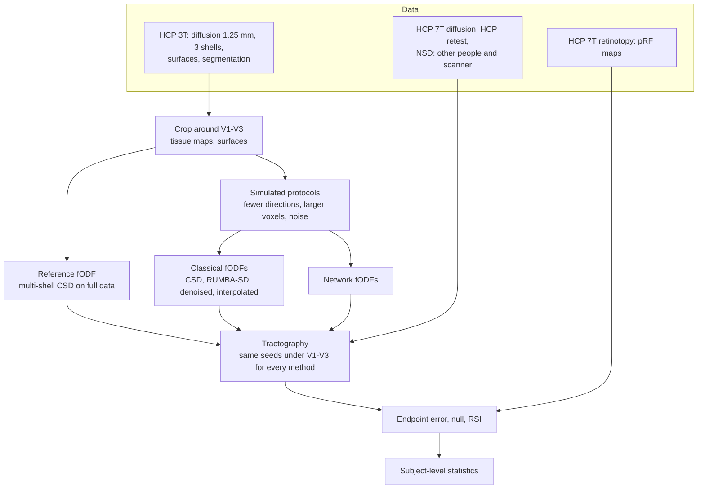
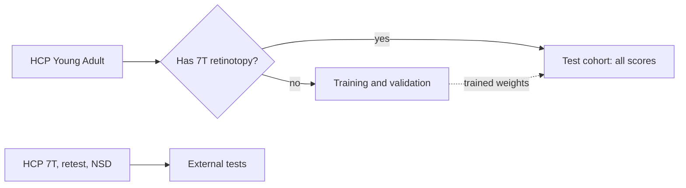
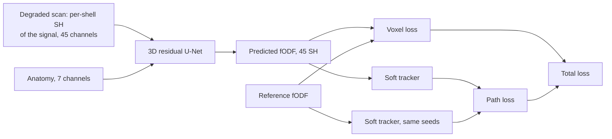

# Overview

## Question

Each point of V1, V2 and V3 responds to one location of the visual field (retinotopy), and the short fibres that
join these areas connect points that represent the same location. High-quality diffusion MRI shows this; with
clinical-grade scans (fewer directions, larger voxels, one b-value) streamlines in superficial white matter end in
the wrong place. Networks that enhance fibre orientation distributions (fODFs) exist, but they are trained and
judged voxel by voxel, which says little about where a streamline crossing twenty voxels ends.

This project asks whether a network can recover the retinotopic organisation from clinical-grade scans, and
whether training it on paths instead of single voxels recovers more of it. The organisation itself is known; it
is used as the reference that a tractogram either reproduces or does not.

## What we do

1. **Score tractograms against measured retinotopy.** For every streamline between two of V1–V3, the endpoint
   error is the visual-field distance between the measured pRF centres of its two ends. Nearby cortex has similar
   retinotopy, so each streamline is compared with surrogates that keep one end and move the other to a point of
   the same area at the same distance. `RSI = 1 − median(error) / median(surrogate error)`: 0 is no better than
   distance alone, 1 is perfect.
2. **Map the loss** of RSI as the HCP reference data are degraded towards clinical-grade protocols.
3. **Train a network with a path-consistency loss.** A 3D U-Net predicts the fODF from a degraded scan. A
   differentiable tracker follows short paths from seeds under the cortex through the predicted and the reference
   fODF, and the distance between the two paths is penalised. Retinotopy is never used in training.

| | Hypothesis |
|---|---|
| H1 | On full-quality data, V1–V2, V2–V3 and V1–V3 streamlines have RSI > 0 |
| H2 | Under degradation, a voxel-loss network recovers more of the lost voxel accuracy than of the lost RSI |
| H3 | Adding the path loss to the same network gives higher RSI on clinical-grade protocols without lower voxel accuracy |

H3 is decided by two networks that differ only in the loss (`path` vs `voxel`).

## Pipeline

Only a box around V1–V3 is processed, on a 1.25 mm grid. HCP and NSD files are each in one subject space, so
there is no registration step. Every method is tracked on the same grid with the same tissue maps, seeds and
settings, so methods differ only in the fODF.

## Subjects

No subject with measured retinotopy is used in training. Lists are drawn once with the seed (`outputs/subjects.json`).

## Network and loss

Methods compared on the same footing: classical CSD, RUMBA-SD, CSD after denoising or after interpolation, a
voxel-wise MLP, an fODF-to-fODF refiner in the style of FOD-Net, the U-Net with voxel loss only, the U-Net with
the path loss and its ablations, and a proximity-only bound that ignores diffusion. Probabilistic tracking of the
same fODFs checks that conclusions do not depend on the tracker. Besides the measured pRF maps, every tractogram
is also scored with the group-average pRF maps and with an anatomical atlas (Benson 2014), the only key a clinical
dataset would have.

## Notebooks

| Notebook | Does | Writes (`outputs/results/` unless noted) |
|---|---|---|
| `00_env_check` | Versions, device, HCP keys | — |
| `01_download_data` | Downloads, subject lists | `data/`, `outputs/subjects.json` |
| `02_preprocessing` | Crops, reference fODFs, network inputs | `data/cache/` |
| `03_retinotopy_metric` | Reference tractogram and proximity bound (H1) | `h1_reference.csv` |
| `04_protocol_map` | Classical methods on every protocol; probabilistic tracker | `protocols.csv` |
| `05_training` | All network variants | `outputs/models/` |
| `06_inference_eval` | Networks on the clinical-grade protocols (H2, H3) | `learned.csv` |
| `07_external_tests` | HCP 7T, HCP retest, NSD | `external_*.csv`, `retest_*.csv`, `nsd_run_overlap.csv` |
| `08_ablations_robustness` | Other analysis choices, ablations | `robustness.csv` |
| `09_stats_figures_tables` | Tests, summary tables, figures | `*_tests.csv`, `*_results.csv`, `outputs/figures/` |

Details: [preprocessing.md](preprocessing.md), [network.md](network.md), [scoring.md](scoring.md),
[code.md](code.md).
